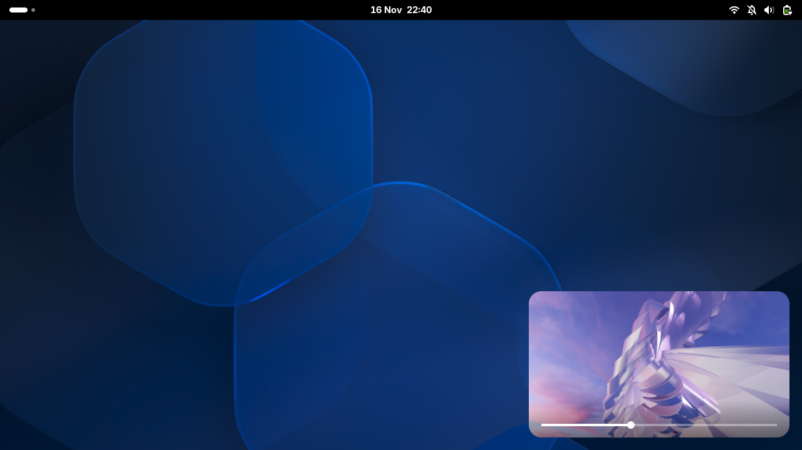

# Auto PiP Manager

**GNOME Shell extension** that automatically manages Picture-in-Picture windows and adds macOS-like behaviour.

[GNOME Extensions](https://extensions.gnome.org/extension/9827/auto-pip-manager/) · [Русская версия](README.ru.md)



## Features

- Keeps PiP windows **above all other windows**
- Makes PiP windows visible **on every workspace**
- Moves a new PiP window to the **chosen corner** of the screen
- **Snaps** a PiP window to the nearest screen corner after you move or resize it; the new corner is remembered for the next PiP window
- Keeps a PiP window in its corner when the app resizes it (e.g. a video with a different aspect ratio)
- Draws PiP windows with **rounded corners** (adjustable radius)
- No Top Bar icon and no background processes: the extension only reacts to window events

PiP windows are detected by window title or WM class (`Picture-in-Picture` and similar), so it works with Firefox and Chromium-based browsers.

## Requirements

- GNOME Shell 51

## Installation

Install from [extensions.gnome.org](https://extensions.gnome.org/extension/9827/auto-pip-manager/) or from source:

```bash
git clone https://github.com/EvilX/nextpinp.git
cd nextpinp
./install.sh
gnome-extensions enable nextpinp@leonid.nasedkin
```

After installing or updating, log out and log back in so GNOME Shell loads the new code.

## Settings

Open the preferences window via the **Extensions** app or:

```bash
gnome-extensions prefs nextpinp@leonid.nasedkin
```

| Setting | Description | Default |
|---------|-------------|---------|
| Always on Top | Keep PiP windows above all other windows | On |
| Always Visible on All Workspaces | Show PiP windows on every workspace | On |
| Corner | Screen corner where PiP windows are placed (also updated when you drag a PiP window to another corner) | Bottom Right |
| Offset | Distance from the screen corner in pixels (0–50) | 20 |
| Corner Radius | Rounding of the PiP window corners in pixels (0–32, 0 disables) | 20 |

Available corners: Top Left, Top Right, Bottom Right, Bottom Left.

## Building a release archive

```bash
./build.sh
```

This produces `dist/nextpinp@leonid.nasedkin.shell-extension.zip` ready for upload to extensions.gnome.org.

## Development

```bash
npm install
npm run lint
npm test
```

GitHub Actions runs lint and tests on every push and pull request, then builds the archive (available as a workflow artifact).

To publish a release, bump `version` in `metadata.json`, commit, and push a matching tag:

```bash
git tag v11 && git push origin v11
```

The workflow checks that the tag matches `metadata.json` and creates a GitHub release with the archive attached.

## Adding a new translation

1. Copy `po/ru.po` to `po/<lang>.po` (e.g. `po/de.po`)
2. Translate the `msgstr` values
3. Run `./install.sh`: the new `.mo` file is compiled automatically

## Project structure

```
├── extension.js       Main extension logic (placement, snapping, rounded corners)
├── prefs.js           Preferences UI (libadwaita)
├── metadata.json      Extension metadata
├── schemas/           GSettings schema
├── po/                Translation sources (.po)
├── install.sh         Build & install script
├── build.sh           Release archive build script
├── tests/             Unit tests (node:test)
└── screenshot.png     Screenshot
```

## License

GPL-2.0-or-later
