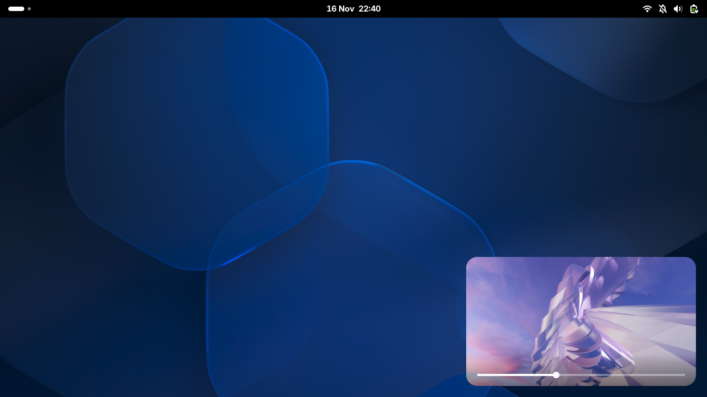

# Auto PiP Manager

**Расширение для GNOME Shell**, которое автоматически управляет окнами режима «картинка в картинке» и добавляет поведение как в macOS.

[Последний релиз](https://github.com/EvilX/nextpinp/releases/latest) · [GNOME Extensions](https://extensions.gnome.org/extension/9827/auto-pip-manager/) · [English version](README.md)



## Возможности

- Закрепляет PiP-окна **поверх всех остальных окон**
- Делает PiP-окна видимыми **на каждом рабочем столе**
- Перемещает новое PiP-окно в **выбранный угол** экрана
- **Притягивает** PiP-окно к ближайшему углу экрана после перемещения или изменения размера; новый угол запоминается для следующих PiP-окон
- Удерживает PiP-окно в углу, когда приложение само меняет его размер (например, у видео другие пропорции)
- Отображает PiP-окна со **скруглёнными углами** (радиус настраивается)
- Нет иконки в верхней панели и фоновых процессов: расширение только реагирует на события окон

PiP-окна определяются по заголовку или WM-классу окна (`Picture-in-Picture` и похожие), поэтому расширение работает с Firefox и браузерами на основе Chromium.

## Требования

- GNOME Shell 51

## Установка

Установите с [extensions.gnome.org](https://extensions.gnome.org/extension/9827/auto-pip-manager/), из [последнего релиза](https://github.com/EvilX/nextpinp/releases/latest/download/nextpinp@leonid.nasedkin.shell-extension.zip):

```bash
curl -LO https://github.com/EvilX/nextpinp/releases/latest/download/nextpinp@leonid.nasedkin.shell-extension.zip
gnome-extensions install --force nextpinp@leonid.nasedkin.shell-extension.zip
gnome-extensions enable nextpinp@leonid.nasedkin
```

или из исходников:

```bash
git clone https://github.com/EvilX/nextpinp.git
cd nextpinp
./install.sh
gnome-extensions enable nextpinp@leonid.nasedkin
```

После установки или обновления нужно выйти из сессии и зайти снова, чтобы GNOME Shell загрузил новый код.

## Настройки

Открыть окно настроек через приложение **Расширения** или:

```bash
gnome-extensions prefs nextpinp@leonid.nasedkin
```

| Параметр | Описание | По умолчанию |
|----------|----------|--------------|
| Поверх всех окон | Держать PiP-окна поверх всех остальных окон | Вкл. |
| Показывать на всех рабочих столах | Отображать PiP-окна на каждом рабочем столе | Вкл. |
| Угол экрана | Угол, в который перемещается PiP-окно (обновляется, когда вы перетаскиваете PiP-окно в другой угол) | Справа-Снизу |
| Отступ | Расстояние от угла экрана в пикселях (0–50) | 20 |
| Радиус скругления | Скругление углов PiP-окна в пикселях (0–32, 0 — выключено) | 20 |

Доступные углы: Слева-Вверху, Справа-Вверху, Справа-Снизу, Слева-Снизу.

## Сборка архива для публикации

```bash
./build.sh
```

Получится `dist/nextpinp@leonid.nasedkin.shell-extension.zip`, готовый для загрузки на extensions.gnome.org.

## Разработка

```bash
npm install
npm run lint
npm test
```

GitHub Actions на каждый push и pull request запускает линтер и тесты, затем собирает архив (доступен как артефакт workflow).

Чтобы выпустить релиз, увеличьте `version` в `metadata.json`, закоммитьте и запушьте соответствующий тег:

```bash
git tag v11 && git push origin v11
```

Workflow проверит, что тег совпадает с `metadata.json`, и создаст GitHub-релиз с приложенным архивом.

## Добавление нового языка

1. Скопировать `po/ru.po` в `po/<код>.po` (например, `po/de.po`)
2. Перевести строки `msgstr`
3. Запустить `./install.sh`: новый `.mo`-файл скомпилируется автоматически

## Структура проекта

```
├── extension.js       Основная логика (размещение, притягивание к углам, скругление)
├── prefs.js           Интерфейс настроек (libadwaita)
├── metadata.json      Метаданные расширения
├── schemas/           Схема GSettings
├── po/                Исходники переводов (.po)
├── install.sh         Скрипт сборки и установки
├── build.sh           Сборка архива для публикации
├── tests/             Юнит-тесты (node:test)
└── screenshot.png     Скриншот
```

## Лицензия

GPL-2.0-or-later
